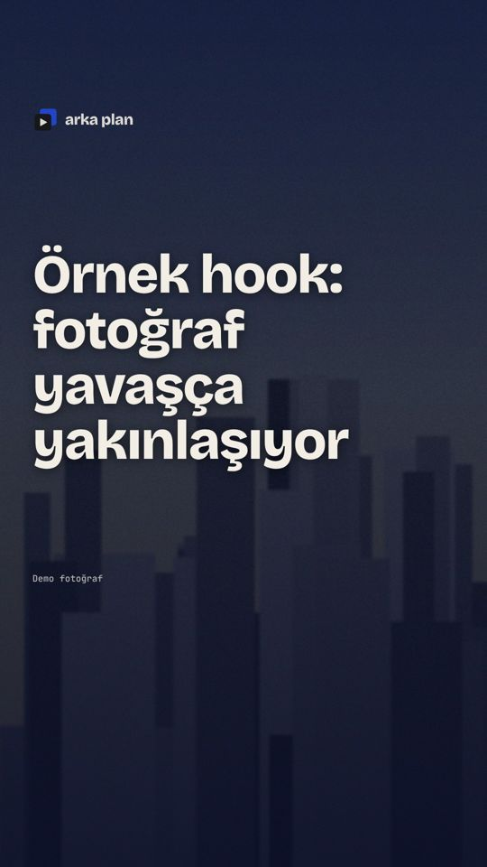
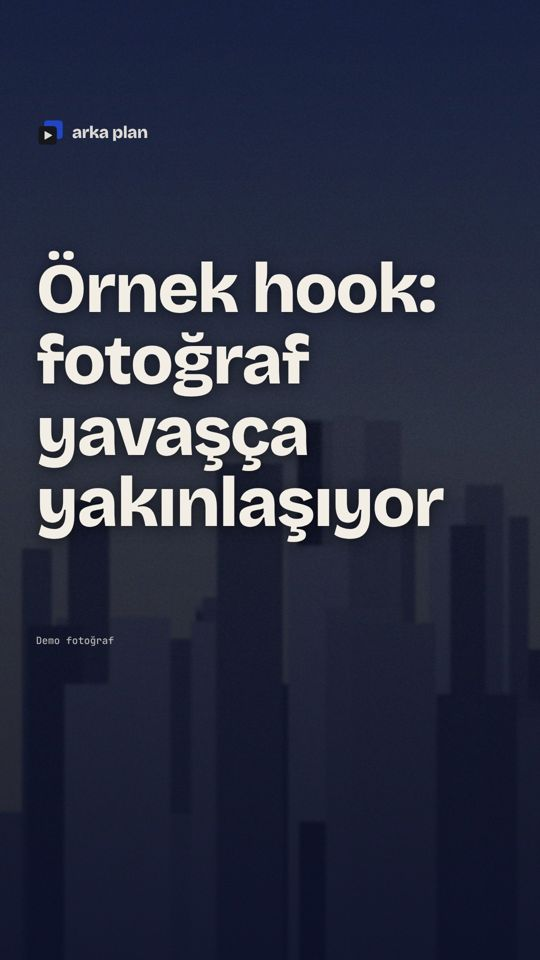
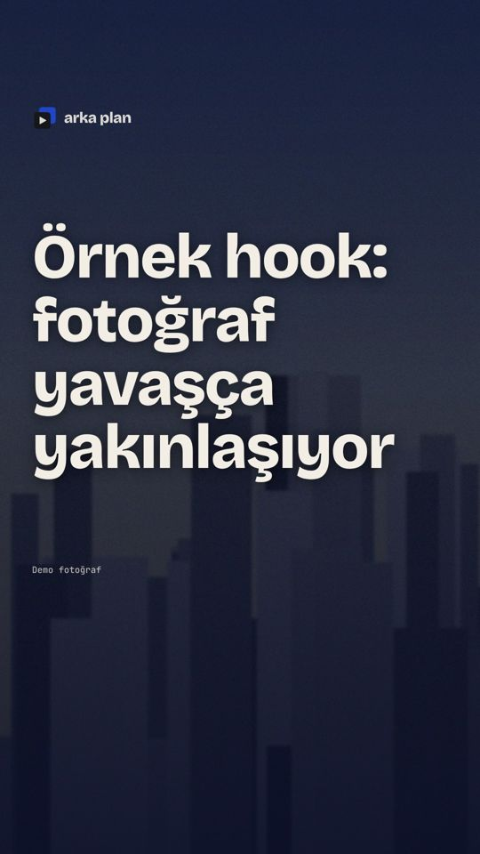

# Hook kapısı · hook-demo-foto

30 fps, 1080x1920. Kareler: 0 (0,00 sn), 15 (0,50 sn), 45 (1,50 sn).

| Kontrol | Sonuç | Ayrıntı |
|---|---|---|
| Metin 0. karede var | ✅ | 93733 metin pikseli |
| Reels güvenli alanı | ✅ | metin x 75–772, y 543–1042; alan x 72–940, y 220–1540 |
| 4:5 kapak kırpması | ✅ | metin y 543–1042; kırpma y 285–1635 |
| Altyazı bloğuyla çakışma yok | ✅ | metin alt 1042 < altyazı üst 1300 |
| Hareket (0→15 kare) | ✅ | ortalama fark 16.19 / 255 (eşik 0,5) |
| Hareket (15→45 kare) | ✅ | ortalama fark 2.54 / 255 (eşik 0,5) |
| Whoosh -18 LUFS civarı | ✅ | -18 LUFS, tepe -8.6 dBTP (hedef -18 ± 2) |
| Whoosh müziğin üstünde | ✅ | whoosh -18 LUFS, hook sırasında müzik -50.4 LUFS (-32.4 -18 dB); en az 3 LU fark |
| Ses ilk 1,5 sn içinde (render) | ✅ | tepe -8.7 dB (eşik -40 dB) |

**GEÇTİ**

| 0. kare | 15. kare | 45. kare |
|---|---|---|
|  |  |  |

Elle bakılacak: 0. karede logo animasyonu ya da kanal girişi yok; filigran 0. karede görünüyor.
