# VERIFY · turkiye-f35

Üretim: 2026-10-24 13:23 UTC · Kompozisyon `turkiye-f35` · 49.73 sn

**Sonuç: engelleyici bulgu yok; ⚠️ = ölçülemedi ya da elle bakılmalı.**

## Teknik

| Kontrol | Sonuç | Ayrıntı |
|---|---|---|
| Video dosyası | ✅ | out/turkiye-f35.mp4 |
| Süre ≤ 60,0 sn | ✅ | 49.733 sn |
| Hedef 56–58 sn | ⚠️ | 49.73 sn — 24 Eki revizyonu: konuşma bitince doğrudan kapanış kartı (sondaki boşluk ve soru çıkarıldı), hedefin altında kalması bilinçli |
| H.264 1080x1920 30 fps yuv420p | ✅ | h264 High 1080x1920 30/1 yuv420p |
| AAC 192 kbps 48 kHz | ✅ | aac 196 kbps 48000 Hz ortalama (kodlayıcı -b:a 192k; konuşma tek kanal olduğu için ortalama düşer) |
| Son 2 sn kapanış kartı | ✅ | S9 47.733 sn → 49.733 sn |
| Konuşma kapanış kartından önce biter | ✅ | konuşma sonu 47.525 sn, kart 47.733 sn |

## Hook

| Kontrol | Sonuç | Ayrıntı |
|---|---|---|
| Hareket 0→15. kare | ✅ | ortalama fark 4.19/255 |
| Hareket 15→45. kare | ✅ | ortalama fark 7.36/255 (sayaç 12. karede durdu, kamera itişi sürüyor) |
| Alıntı 0. karede yazılmaya başlıyor ("Şark") | ✅ | 5263 metin pikseli, x 206–436, y 658–766 |
| Alıntı güvenli alanda | ✅ | kare 0 (0,00 sn) |
| Logo girişi yok | ✅ | S1 0. karede fotoğraf + alıntı; logo yalnızca S9 kapanış kartında |
| Sayaç 0→6, 12 karede durur | ✅ | başlangıç 3.03 sn, duruş 3.429 sn (vuruşa hizalı) |

## Güvenli alan

| Kontrol | Sonuç | Ayrıntı |
|---|---|---|
| S1 (üst 220 / alt 380 / sağ 140) | ✅ | taşan piksel: üst 0, alt 0, sağ 0 |
| S2 (üst 220 / alt 380 / sağ 140) | ✅ | taşan piksel: üst 0, alt 0, sağ 27 |
| S3 (üst 220 / alt 380 / sağ 140) | ✅ | taşan piksel: üst 0, alt 0, sağ 0 |
| S4 (üst 220 / alt 380 / sağ 140) | ✅ | taşan piksel: üst 0, alt 0, sağ 0 |
| S5 (üst 220 / alt 380 / sağ 140) | ✅ | taşan piksel: üst 0, alt 0, sağ 0 |
| S6 (üst 220 / alt 380 / sağ 140) | ✅ | taşan piksel: üst 0, alt 0, sağ 0 |
| S7 (üst 220 / alt 380 / sağ 140) | ✅ | taşan piksel: üst 0, alt 0, sağ 0 |
| S8 (üst 220 / alt 380 / sağ 140) | ✅ | taşan piksel: üst 0, alt 0, sağ 0 |

## Altyazı

| Kontrol | Sonuç | Ayrıntı |
|---|---|---|
| ASR senkronu (p95 ≤ 0,25 sn) | ✅ | faster-whisper medium (final MP4, GitHub Actions); eşleşme %85, ortalama 0.017 sn, p95 0.042 sn, en kötü 0.261 sn |
| Kelime zamanlaması | ✅ | faster-whisper medium (önbellek, orijinal kayıt); senaryo eşleşmesi %88 |
| Alıntı cümlesinin altyazısı gösterilmiyor | ✅ | S1 ilk cümle gizli (ekranda zaten yazılı) |
| Okunuş yazımları altyazıda yok | ✅ | ef otuz beş, es dört yüz, Emirlikler, Amerika → yok |
| F-35 / S-400 / BAE doğru yazımı | ✅ | altyazıda: F-35, S-400, BAE |
| En fazla iki satır | ✅ | en uzun parça 39 harf; render'da ölçülerek en fazla 2 satıra dizilir (sığmazsa hata verir) |

## B-roll

| Kontrol | Sonuç | Ayrıntı |
|---|---|---|
| Yüz taraması (OpenCV) | ⚠️ | kullanılan klip yok |

## Ses

| Kontrol | Sonuç | Ayrıntı |
|---|---|---|
| Entegre loudness -14 LUFS (±1) | ✅ | -13.9 LUFS |
| Gerçek tepe ≤ -1 dBTP | ✅ | -2 dBTP |
| Müzik | ✅ | music_f35.mp3, BPM 99.32 (librosa (beat_track 99.4, ızgara uydurma)), ilk vuruş 0.24 sn |
| Müziğin konuşmayı bastırdığı saniye | ✅ | yok (konuşma her saniyede müziğin en az 10 dB üstünde) |
| SFX (en fazla 8 olay, müziğin altında) | ✅ | type @ 0 sn (-35 dB, sentez (tools/f35/prep_audio.py)); stamp @ 5.886 sn (-39 dB, sentez (tools/f35/prep_audio.py)); paper @ 15.047 sn (-39 dB, sentez (tools/f35/prep_audio.py)); stamp @ 17.486 sn (-39 dB, sentez (tools/f35/prep_audio.py)); stamp @ 26.362 sn (-39 dB, sentez (tools/f35/prep_audio.py)); whoosh @ 3.429 sn (-35 dB, sentez (tools/f35/prep_audio.py)); stamp @ 40.971 sn (-39 dB, sentez (tools/f35/prep_audio.py)); metal @ 45.2 sn (-39 dB, sentez (tools/f35/prep_audio.py)) |
| Vuruş hizalaması (≤ 3 kare) | ✅ | {"S3":-3,"S4":-1,"S7":-1,"S8":-1} |

## Tarafsızlık

| Kontrol | Sonuç | Ayrıntı |
|---|---|---|
| Değer yüklü kelime taraması | ✅ | 28 kelime tarandı, bulgu yok |
| S7: "Hiçbir hükümet doğrulamadı" ifadesi | ✅ | Türk basını: S-400 Körfez'e satılıyor. Hiçbir hükümet doğrulamadı. |
| S4 iki taraf: aynı bileşen, genişlik, punto, renk, süre | ✅ | SplitCard (xl), iki sütun 1fr/1fr, ikisi de NEUTRAL_LINE, aynı kare (startFrame 6) ve sahne sonuna kadar birlikte; metin uzunluğu 64/38 harf |
| Alıntılar isim · unvan · tarih ve "özet" etiketiyle | ✅ | Donald Trump · ABD Başkanı · 7 Tem 2026 / Sergey Lavrov · Rusya Dışişleri Bakanı · 26 Eyl 2026 |
| S8 Rubio satırı isim · unvan · tarih | ✅ | Marco Rubio · ABD Dışişleri Bakanı · 7 Eki 2026: S-400 çözülmeden yasal olarak mümkün değil. |
| Tanpınar alıntısı edebi epigraf | ✅ | Ahmet Hamdi Tanpınar · Huzur (1949); ülke/kişi yorumu olarak sunulmuyor (SOURCES.md: Huzur, 1949, birinci bölüm) |
| Seslendirmede yorum içeren ifade | ⚠️ | S7: "Çözüm onları satmak." kayıttaki ifade; satışı bir çözüm olarak sunuyor. Altyazı kayda bağlı olduğu için değiştirilmedi — yeniden seslendirmede "Bir seçenek satış." gibi atıflı bir ifade önerilir |
| S4 iki taraf: piksel alanı sol/sağ | ✅ | 209943 / 215874 px (oran 1.03, kare 665) |
| S6 iki paket: piksel alanı sol/sağ | ✅ | 288184 / 288265 px (oran 1.00, kare 1092) |
| S8 iki paket + iki anahtar: piksel alanı sol/sağ | ✅ | 241026 / 240518 px (oran 1.00, kare 1363) |
| S4 taraf satırları | ⚠️ | Pentagon · 17 Tem 2019 / Türk hükümeti · 7 Tem 2026 — Ankara ifadesinin sahibi (isim/unvan) Medyascope 7 Tem 2026 haberinden doğrulanmalı |

## Gün sayacı

| Kontrol | Sonuç | Ayrıntı |
|---|---|---|
| BEKLEME değeri (publishDate) | ✅ | 2019-07-17 → 2026-10-24 = 2656 gün; S9'a girerken bu değere ulaşır, S6'da donar |
| Konum: sağ üst, güvenli alan içinde | ✅ | x ≤ 940, y 230–272; altyazı 1372–1540, kartlar ve üst etiketler y ≥ 290 → çakışma yok (güvenli alan QA karelerinde görülebilir) |

## Taklit

| Kontrol | Sonuç | Ayrıntı |
|---|---|---|
| Gerçek kurum logosu / arayüz taklidi yok | ✅ | Takip ekranı yalnızca kanal paleti, Bricolage/JetBrains/Playfair ve iki durum rengiyle çizildi; hiçbir kargo firması, Lockheed Martin, USAF ya da kurum logosu/belge düzeni kullanılmadı. Haritada kullanıcı isteğiyle (24 Eki) küçük ülke bayrakları var; resmî arma/amblem çizilmedi |
| Fotoğraflardaki işaretler | ⚠️ | F-35A fotoğrafında uçağın kendi kuyruk numarası ve birlik işaretleri görünür (fotoğrafın doğal parçası, logo kullanımı değil). Bayraklı aday (Commons #0) bu nedenle kullanılmadı |

## Kapak

| Kontrol | Sonuç | Ayrıntı |
|---|---|---|
| 3:4 önizlemede alıntının tamamı | ✅ | alıntı y 420–~900, yazar ~940, damga 1270–1450, "6 F-35 · 7 YIL" ~1490, kredi 1560: hepsi 1080x1440 (y 240–1680) ve 4:5 (y 285–1635) içinde; bkz. cover_turkiye-f35_3x4_onizleme.jpg |

## Hook kareleri

| 0. kare (0,00 sn) | 15. kare (0,50 sn) | 45. kare (1,50 sn) | QA: metin (macenta) |
|---|---|---|---|
| 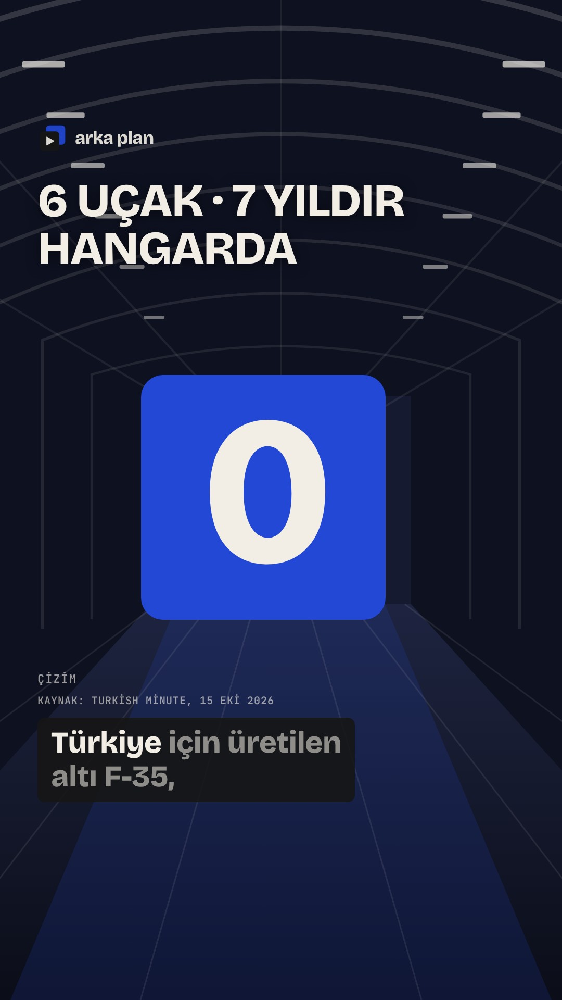 | 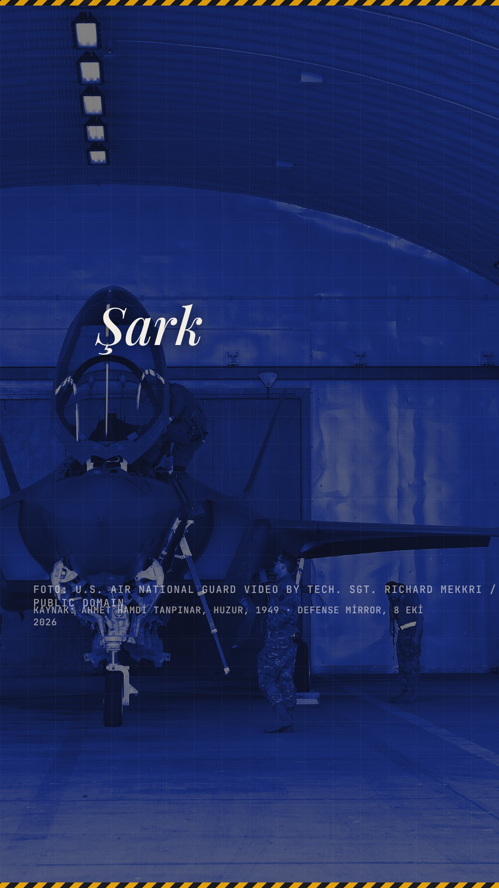 | 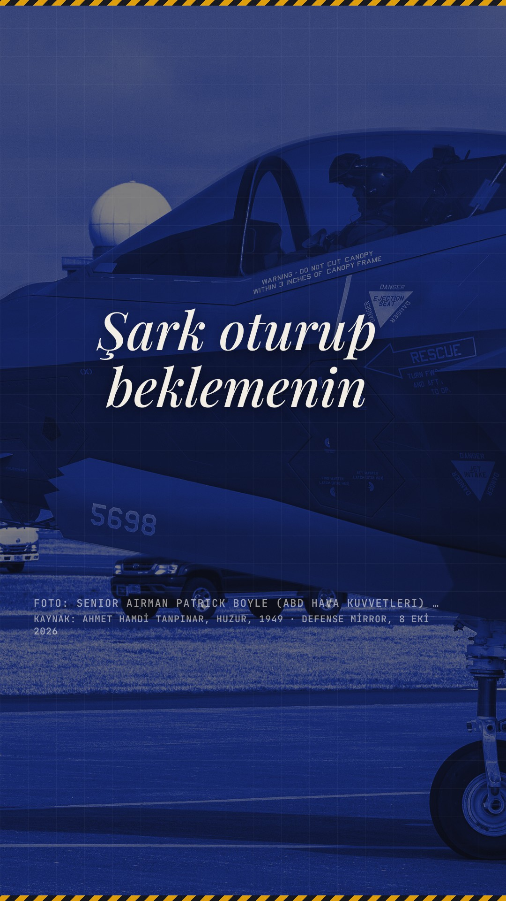 | 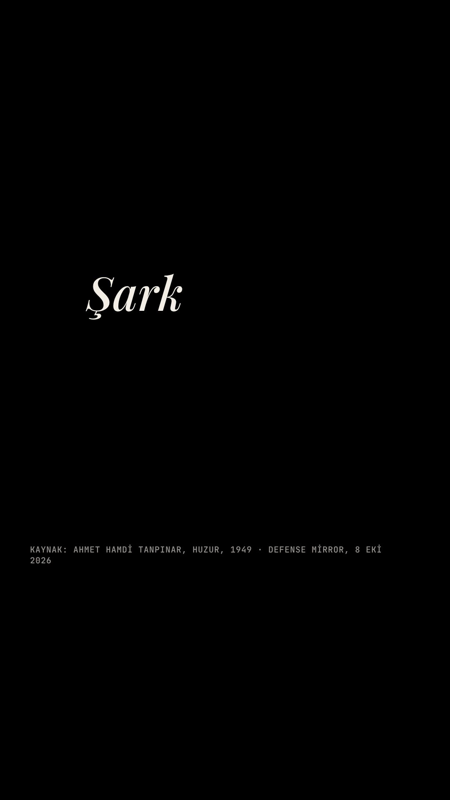 |

## Sahne ortaları (out/qa_f35/)

Taşma, güvenli alan ve okunurluk için gözle bakılacak kareler. Güvenli alan ölçümü zeminsiz QA render'ında yapıldı (`qa_f35/guvenli_alan/`).

| Sahne | Kare | Üst | Alt | Sağ | |
|---|---|---|---|---|---|
| S1 | 168 | 0 | 0 | 0 | ✅ |
| S2 | 359 | 0 | 0 | 27 | ✅ |
| S3 | 526 | 0 | 0 | 0 | ✅ |
| S4 | 712 | 0 | 0 | 0 | ✅ |
| S5 | 884 | 0 | 0 | 0 | ✅ |
| S6 | 1082 | 0 | 0 | 0 | ✅ |
| S7 | 1267 | 0 | 0 | 0 | ✅ |
| S8 | 1411 | 0 | 0 | 0 | ✅ |

S1: 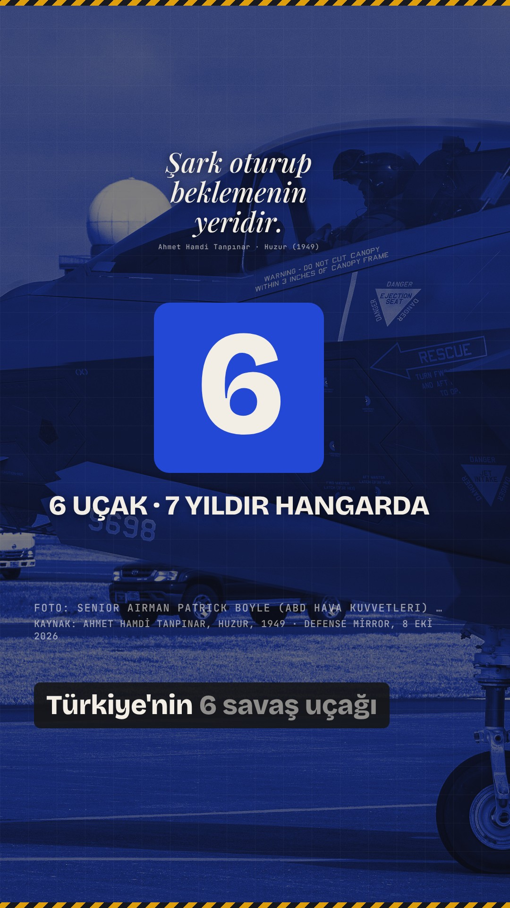
S2: 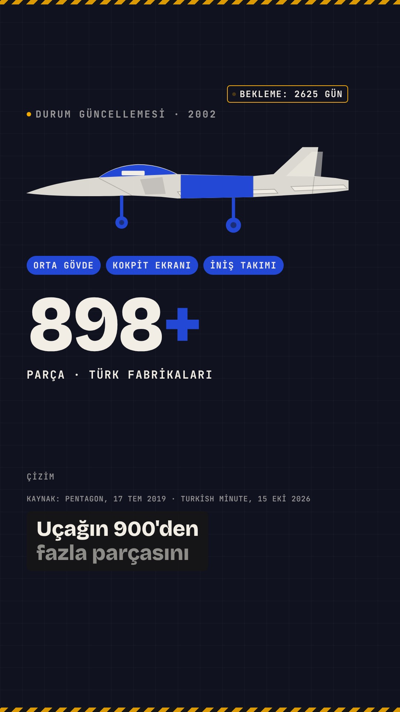
S3: 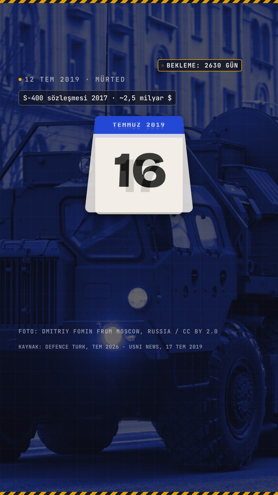
S4: 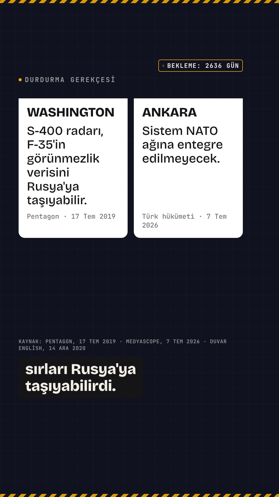
S5: 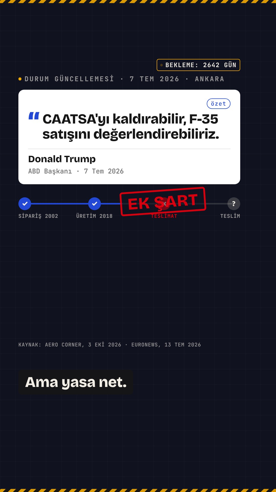
S6: 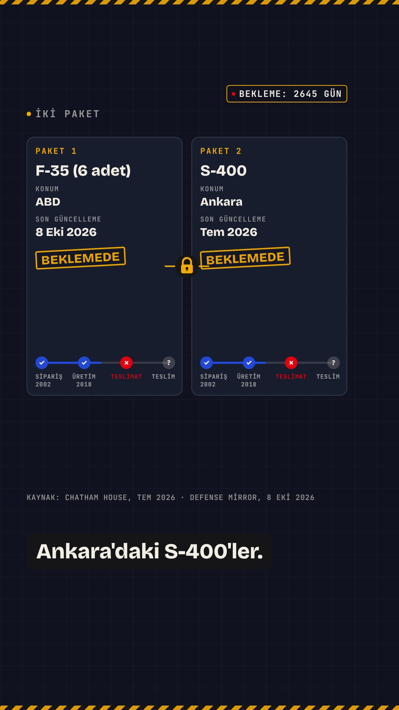
S7: 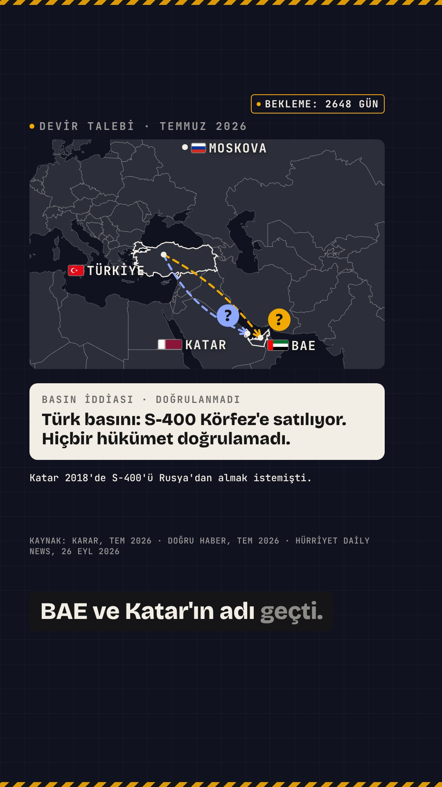
S8: 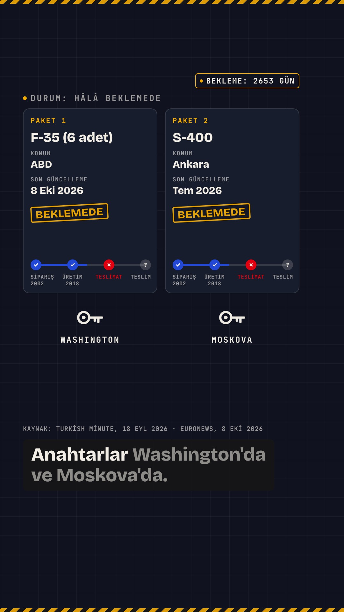
S9: 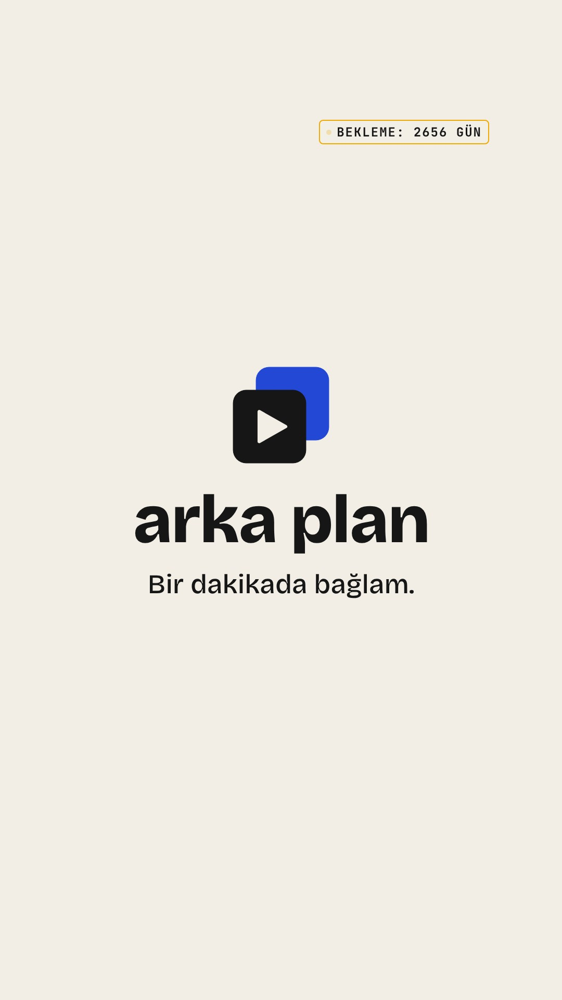

Okunurluk: altyazı 58 px (en az 46 px), başlıklar ≥ 50 px, kart metni ≥ 36 px; KAYNAK satırı ve "ÇİZİM/Temsili görüntü" etiketi 20–22 px mono (bilgi satırı).

## Kullanılan görseller ve lisanslar

- f35a-usaf: File:F35A Lightning IIs arrive at Misawa Air Base (9588487).jpg · U.S. Air Force photo by Senior Airman Patrick Boyle · Public domain · https://commons.wikimedia.org/wiki/File:F35A_Lightning_IIs_arrive_at_Misawa_Air_Base_(9588487).jpg · parallax (yoğunluk 0.5)
- s400-milru: File:S-400 Triumf (27102989027).jpg · Dmitriy Fomin from Moscow, Russia · CC BY 2.0 · https://commons.wikimedia.org/wiki/File:S-400_Triumf_(27102989027).jpg · parallax (yoğunluk 0.5)
- Harita: Natural Earth 1:50m (kamu malı).
- B-roll: yok.

## Eksik dosyalar

- B-roll S3 → fotoğraf/çizim kullanıldı
- B-roll S6 → fotoğraf/çizim kullanıldı
- motion-showreel/scripts/sfx.mjs (SFX tools/f35/prep_audio.py içinde sentezlendi)

## Uyarılar

- Toplam süre 49.733 sn, hedef 56–58 sn dışında
- S1 piyano girişi: public/music_f35_piano.mp3 yok, müzik filtrelenerek yaklaşık piyano bölgesi kullanıldı
- PEXELS_API_KEY yok: Pexels atlandı
- PIXABAY_API_KEY yok: Pixabay atlandı
- S1: kabul edilen klip yok (sahne fotoğraf/çizimle kalır)
- S3: kabul edilen klip yok (sahne fotoğraf/çizimle kalır)
- S6: kabul edilen klip yok (sahne fotoğraf/çizimle kalır)
- S7: kabul edilen klip yok (sahne fotoğraf/çizimle kalır)

## İçerik doğrulama notları (yayından önce)

- Ekim 2026 tarihli kaynaklar (Turkish Minute, Defense Mirror, Euronews, Aero Corner) ve Temmuz–Eylül 2026 olayları brief'ten alındı; bu oturumda bağımsız olarak doğrulanamadı. Her kaynağa URL eklenmeli (SOURCES.md).
- S3 "S-400 sözleşmesi 2017": imza Eylül 2017'de açıklanmıştı; tarih yalnızca yıl olarak verildi.
- "6 uçak 7 yıldır ABD'de": Temmuz 2020 tarihli haberlere (Reuters) göre ABD Hava Kuvvetleri, Türkiye için üretilen 8 F-35A'yı kendi envanterine almak üzere sözleşme değişikliği yapmıştı. "6 uçak" ifadesi Defense Mirror (8 Eki 2026) haberiyle birebir eşleştirilmeli.
- S4 Ankara satırının sahibi (isim, unvan) netleştirilmeli; şu an "Türk hükümeti · 7 Tem 2026".
- Seslendirme senaryosu `src/data/f35.ts` içindedir. Kayıt bu metinden farklıysa Whisper eşleşme oranı düşer ve uyarı verir; altyazı yine senaryodan yazılır.
